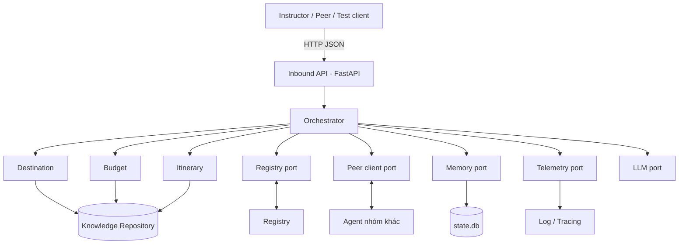

# Hướng dẫn triển khai Travel Agent Hà Nội

> Bài tập lớn môn Hệ thống phân tán — Multi-Agent Distributed System
> Phạm vi nhóm: **AI Agent du lịch Hà Nội** (1–3 ngày, nội thành và vài điểm ven đô gần)

Tài liệu gồm hai phần lớn:

- **Phần A (mục 1–5):** bức tranh tổng thể, lộ trình 6 giai đoạn, ý nghĩa của từng giai đoạn trong hệ thống phân tán.
- **Phần B (mục 6):** hướng dẫn chi tiết việc đầu tiên cần làm — **mở rộng và kiểm chứng dữ liệu lên 40–60 địa điểm**.

Quy ước: ☐ là việc cần làm, ✅ là tiêu chí hoàn thành (Definition of Done).

---

## 1. Bối cảnh và mục tiêu

Mỗi nhóm xây **một AI Agent độc lập**; cả lớp ghép thành một hệ thống phân tán. Agent phải chạy như một **network service**, có danh tính, có knowledge riêng, giao tiếp được với agent khác, và phải sống sót khi mạng hoặc node gặp sự cố. LLM chỉ là một thành phần; **thiết kế hệ thống phân tán mới là trọng tâm** (theo slide môn học).

| Yêu cầu của BTL | Nhóm đáp ứng bằng |
|---|---|
| Identity (Agent ID, Group ID, domain, capability) | Agent Card + `app/config.py` |
| Endpoint (network API, health check) | FastAPI: `/health`, `/v1/tasks`, `/v1/ask` |
| Knowledge riêng | Dữ liệu du lịch Hà Nội + quy tắc đi lại, ngân sách |
| Memory bền vững + provenance | SQLite: nguồn, version, TTL, confidence |
| Logs (Message ID, latency, status) | Log JSON có `correlation_id`, `latency_ms` |
| Discovery | Registry client (đăng ký, heartbeat, tìm theo capability) |
| Coordination | Orchestrator gọi song song nhiều agent |
| Fault handling | Timeout, retry, dedup, fallback, partial result |

### Vì sao thu hẹp về Hà Nội là quyết định tốt

- Dữ liệu **sâu và đáng tin** hơn thay vì rộng và nông.
- Phạm vi kiểm thử gọn, dễ tự kiểm chứng.
- Agent khác nhìn vào thấy rõ "chỉ nhóm này mới biết" → có lý do để phối hợp (đây chính là điều slide đòi hỏi).

---

## 2. Kiến trúc



### Năm nguyên tắc thiết kế (nên dán lên đầu repo)

1. **Core không biết chuyện mạng.** Mọi giao tiếp ra ngoài đi qua *port* (interface). Đổi hạ tầng = viết thêm *adapter*, không sửa Core.
2. **Không hardcode địa chỉ.** Tất cả qua biến môi trường (`AGENT_ID`, `PUBLIC_URL`, `REGISTRY_URL`…).
3. **Mọi message đều có `message_id` và `correlation_id`.** Không có thì không debug được hệ thống phân tán.
4. **Giả định mạng luôn có thể hỏng.** Mỗi lần gọi ra ngoài phải có timeout; mỗi lỗi phải có đường lui.
5. **Dữ liệu nào cũng có nguồn gốc.** Kiến thức của riêng nhóm hay học từ agent khác đều ghi nguồn, thời điểm, độ tin cậy.

---

## 3. Lộ trình tổng

| Phần | Milestone | Trọng tâm | Chủ đề môn học | Rubric chính |
|---|---|---|---|---|
| 1 | M1 Build | Identity, domain, knowledge | Web Services/SOA | Domain Agent & knowledge (15%) |
| 2 | M2 Connect | Envelope, `/v1/ask`, Docker, gọi từ máy khác | Communication | Communication & interoperability (15%) |
| 3 | M3 Discover | Registry client, heartbeat | Naming & Discovery | Discovery & protocol (10%) |
| 4 | M4 Learn | Persistent memory, provenance | Replication & Consistency | Knowledge exchange / memory (10%) |
| 5 | M5 Coordinate | Delegate, song song, tổng hợp | Coordination | Coordination (15%) |
| 6 | M6 Survive | Timeout, retry, dedup, fallback | Fault tolerance, Time & Ordering | Reliability (15%) |
| — | Final | discover → communicate → delegate → coordinate → recover → answer | Tất cả | Final challenge (10%), DS design (10%) |

Giảng viên sẽ mở các milestone dần theo tiến độ môn học, nên **hãy xong mỗi phần trước khi milestone tương ứng được mở**. Slide chưa chốt giao thức cụ thể (HTTP/JSON tự định nghĩa hay A2A-compatible), registry, hay định dạng Agent Card; xem mục 7.3 để biết nên hỏi giảng viên những gì.

---

## 4. Chi tiết từng phần

### Phần 1 — M1 Build: có agent chạy được, có kiến thức riêng

**Mục tiêu.** Một service độc lập, có danh tính, trả lời được yêu cầu du lịch Hà Nội bằng dữ liệu của chính nhóm.

**Ý nghĩa trong hệ thống.** Agent không phải chatbot mà là một *node* của hệ thống phân tán. Knowledge riêng là lý do node này tồn tại: nếu ai cũng có cùng dữ liệu thì không cần phối hợp. Agent Card là "căn cước" để các node khác nhận ra nhau ở Phần 3.

**Việc cần làm**
- ☐ Chạy được bộ khung (xem `README.md`), `pytest -q` xanh.
- ☐ Đặt `AGENT_ID`, `GROUP_ID` thật; cập nhật `capabilities` trong Agent Card.
- ☐ **Mở rộng và kiểm chứng dữ liệu lên 40–60 địa điểm (chi tiết ở mục 6).**
- ☐ Cải thiện `itinerary.py`: xếp quán ăn vào khung giờ trưa/tối, kiểm tra giờ mở cửa.
- ☐ Thêm test cho các kịch bản: 1 ngày lịch sử, 2 ngày ẩm thực, ngân sách thấp.

✅ **Hoàn thành khi:** `/health` và Agent Card đúng danh tính; ≥ 40 địa điểm đã kiểm chứng; `python scripts/validate_data.py --strict` không còn lỗi; 3 kịch bản cho kết quả hợp lý.

**Lỗi hay gặp.** Dữ liệu copy từ blog cũ (giá, giờ mở cửa lỗi thời); địa điểm đã đóng cửa; nhầm lat/lon.

---

### Phần 2 — M2 Connect: agent khác gọi được bạn, và bạn gọi được họ

**Mục tiêu.** Chuẩn hóa message, mở thêm `/v1/ask`, đóng gói Docker, để máy khác trong lớp gọi thành công.

**Ý nghĩa trong hệ thống.** Đây là bài học **Communication**: agent chỉ có giá trị khi nói chuyện được với agent khác bằng một *hợp đồng* rõ ràng. Message envelope chuẩn là hợp đồng đó; nó cũng là nơi mang `correlation_id` để truy vết xuyên nhiều node.

**Việc cần làm**
- ☐ Định nghĩa `Envelope` (pydantic) và cho `/v1/tasks` nhận được cả envelope lẫn input cũ (tương thích ngược).

```json
{
  "message_id": "uuid", "correlation_id": "uuid-của-cả-task",
  "from_agent": "...", "to_agent": "...", "type": "request",
  "capability": "plan_trip", "timestamp": "2026-10-17T09:00:00Z",
  "deadline_ms": 5000, "idempotency_key": "...", "payload": {}
}
```

- ☐ Thêm `POST /v1/ask`: agent khác hỏi knowledge của bạn (ví dụ "giá vé Văn Miếu?"), trả lời kèm nguồn và `verified_at`.
- ☐ Thêm `PeerClientPort` + `HttpPeerClient` (dùng `httpx` async). Core **không** import `httpx` trực tiếp.
- ☐ Viết 2 mock peer (Weather Hà Nội, Finance) trong `mock_peers/` để tự test khi chưa có nhóm khác.
- ☐ Viết `Dockerfile` và `docker-compose.yml` chạy agent cùng mock peers.
- ☐ Thử gọi chéo với một nhóm khác qua mạng LAN.

✅ **Hoàn thành khi:** máy khác gọi được `/health`, Agent Card và `/v1/tasks` của bạn; agent bạn gọi được mock peer; mọi log đều có `correlation_id`.

**Lỗi hay gặp.**
- Chạy `uvicorn` mặc định chỉ nghe `127.0.0.1`. Muốn máy khác gọi được phải chạy `uvicorn app.main:app --host 0.0.0.0 --port 8000`.
- `PUBLIC_URL` còn là `localhost` thay vì IP máy thật.
- Windows Firewall chặn cổng 8000 (cho phép inbound cho cổng này).

---

### Phần 3 — M3 Discover: tìm agent theo khả năng, không theo địa chỉ cố định

**Mục tiêu.** Tự đăng ký lên Registry, giữ trạng thái "online" bằng heartbeat, tìm peer theo `domain` hoặc `capability`.

**Ý nghĩa trong hệ thống.** Bài học **Naming & Discovery**: trong hệ thống phân tán, node có thể đến, đi, đổi địa chỉ. Hardcode IP là cách thiết kế mong manh nhất. Discovery cho phép hỏi "ai làm được `weather.forecast`?" thay vì "máy 192.168.1.5 ở đâu?".

**Việc cần làm**
- ☐ Định nghĩa `RegistryPort` với `register`, `heartbeat`, `find`.
- ☐ Cài đặt **hai adapter**: `StaticFileRegistry` (đọc `peers.json`, dùng ngay) và `HttpRegistry` (theo spec giảng viên, làm khi có).
- ☐ Chọn adapter bằng biến môi trường `REGISTRY_IMPL=static_file|http`.
- ☐ Đăng ký lúc khởi động, heartbeat nền (dùng `lifespan` của FastAPI). **Đăng ký thất bại không được làm sập agent**: thử lại ở nền.
- ☐ Cache kết quả `find` theo TTL; nếu Registry chết vẫn dùng bản cache gần nhất.
- ☐ Lọc bỏ peer có `status` là `offline`.

✅ **Hoàn thành khi:** khởi động agent là tự xuất hiện trên Registry; tắt Registry thì agent vẫn gọi được peer đã biết; `find(capability="weather.forecast")` trả đúng peer.

---

### Phần 4 — M4 Learn: nhớ và biết mình nhớ gì, từ ai, mới đến đâu

**Mục tiêu.** Persistent memory có provenance; học từ câu trả lời của agent khác; xử lý dữ liệu cũ và mâu thuẫn.

**Ý nghĩa trong hệ thống.** Bài học **Replication & Consistency**: mỗi bản sao kiến thức (memory) có thể lỗi thời hoặc mâu thuẫn với nguồn gốc. "Học" ở đây là cập nhật memory chứ không phải fine-tune model (theo slide 7).

**Schema gợi ý (SQLite, file `state.db`)**

| Cột | Ý nghĩa |
|---|---|
| `key` | Khóa kiến thức, ví dụ `weather:hanoi:2026-10-20` |
| `content` | Nội dung (JSON) |
| `source_agent` | Agent cung cấp |
| `version` | Tăng mỗi lần cập nhật |
| `confidence` | 0–1 |
| `created_at`, `expires_at` | Mốc thời gian và TTL |

**Việc cần làm**
- ☐ `MemoryPort` với `get`, `put`, `search`, `list_expired`; adapter đầu tiên là SQLite.
- ☐ Quy tắc TTL theo loại dữ liệu (đề xuất, nhóm tự chỉnh): thời tiết sống ngắn, tỷ giá sống ngắn, giá vé và giờ mở cửa sống dài hơn.
- ☐ Khi dữ liệu hết TTL: hỏi lại agent nguồn qua `/v1/ask`; không hỏi được thì dùng bản cũ nhưng **gắn cờ `stale: true`** trong câu trả lời.
- ☐ Chính sách mâu thuẫn (viết thành văn bản, ví dụ): ưu tiên confidence cao hơn, rồi timestamp mới hơn; chênh lệch lớn thì trả cả hai nguồn kèm giải thích.
- ☐ Tách `knowledge.db` (seed, chỉ đọc) khỏi `state.db` (đọc-ghi).

✅ **Hoàn thành khi:** khởi động lại agent vẫn nhớ; mỗi mẩu kiến thức học được đều tra ra nguồn, version, hạn dùng; có test cho tình huống stale và conflict.

---

### Phần 5 — M5 Coordinate: một agent không đủ, phải phối hợp

**Mục tiêu.** Phân rã task, giao cho agent khác, chạy song song, gộp kết quả.

**Ý nghĩa trong hệ thống.** Bài học **Coordination**: ví dụ trong slide — "lập kế hoạch 4 ngày, tránh mưa, không vượt budget, không trùng lịch" — không agent nào làm một mình được. Orchestrator đóng vai *coordinator*.

**Gợi ý phối hợp cho Travel Agent Hà Nội**

| Capability cần | Từ agent | Dùng để |
|---|---|---|
| `weather.forecast` | Weather | Ngày mưa thì ưu tiên điểm `indoor: true` (đây là lý do dữ liệu cần trường `indoor`) |
| `finance.*` | Finance | Kiểm tra ngân sách, quy đổi tiền cho khách nước ngoài |
| `food.recommend` | Food | Bổ sung quán ăn ngoài dữ liệu của bạn |
| `calendar.*` | Calendar | Tránh trùng lịch |

**Việc cần làm**
- ☐ Orchestrator biểu diễn kế hoạch dưới dạng danh sách subtask: `capability`, `payload`, `required` (bắt buộc hay tùy chọn).
- ☐ Tìm agent qua `RegistryPort`, gọi song song bằng `asyncio.gather`, mỗi call có timeout riêng và cả task có deadline tổng.
- ☐ Tổng hợp: ví dụ dự báo mưa ngày 2 → đổi lịch ngày 2 sang địa điểm `indoor`.
- ☐ Subtask tùy chọn thất bại thì vẫn trả kết quả (partial), nêu rõ phần thiếu.
- ☐ Thử phối hợp **≥ 3 agent / 3 nhóm** cùng một task (yêu cầu M5).

✅ **Hoàn thành khi:** một yêu cầu thật sự dùng kết quả của ≥ 2 agent khác; log cho thấy các lời gọi chạy song song; kết quả thay đổi hợp lý khi dữ liệu từ peer thay đổi.

---

### Phần 6 — M6 Survive: hỏng cũng phải có đường lui

**Mục tiêu.** Xử lý timeout, trùng lặp, agent chết, dữ liệu cũ, mạng chậm.

**Ý nghĩa trong hệ thống.** Đây là bài học **Fault tolerance** và cũng là nơi hệ thống phân tán khác hẳn chương trình thường: lỗi là *bình thường*, không phải ngoại lệ. Hãy coi BTL là phòng thí nghiệm (slide 9).

| Sự cố | Cách xử lý | Cài ở đâu |
|---|---|---|
| Timeout | Timeout mỗi call + deadline tổng | Peer client |
| Retry gây trùng request | `idempotency_key` giữ nguyên khi retry; bên nhận lưu `processed_messages` và trả lại response cũ | Peer client + API |
| Agent down | Circuit breaker (mở sau vài lần lỗi liên tiếp, thử lại sau một khoảng) → fallback sang peer khác cùng capability → memory (gắn cờ `stale`) → partial result | Peer client + Orchestrator |
| Dữ liệu cũ | Kiểm tra TTL, làm mới hoặc gắn cờ | Memory |
| Hai agent trả lời khác nhau | Chính sách conflict ở Phần 4 | Orchestrator |
| Mạng chậm | Timeout hợp lý + trả partial thay vì chờ mãi | Orchestrator |

**Việc cần làm**
- ☐ Retry với exponential backoff và jitter, giới hạn số lần.
- ☐ Bảng `processed_messages(message_id, response, created_at)` để dedup request đến.
- ☐ Circuit breaker đơn giản (đếm lỗi liên tiếp theo từng peer).
- ☐ Chuỗi fallback và `status: "partial"` kèm `missing: [...]`.
- ☐ **Fault injection cho mock peer** qua biến môi trường: `FAULT_DELAY_MS`, `FAULT_DROP_RATE`, `FAULT_DUPLICATE`, `FAULT_DOWN`.
- ☐ Bộ test kịch bản lỗi (mỗi dòng bảng trên là một test).
- ☐ Time & Ordering: mọi log có timestamp và `correlation_id` để dựng lại trình tự.

✅ **Hoàn thành khi:** với mỗi sự cố ở bảng trên, agent vẫn trả lời có ý nghĩa và log cho thấy nó đã xử lý thế nào.

---

### Final challenge

Chuỗi cần chạy trơn: **discover → communicate → delegate → coordinate → recover → answer**.

- ☐ Chạy trọn chuỗi với ≥ 3 agent thật.
- ☐ Chạy lại với một agent bị tắt giữa chừng.
- ☐ Tài liệu thiết kế (mục "Distributed-system design", 10% rubric) nêu rõ các quyết định: vì sao dùng ports/adapters, chính sách TTL, chính sách conflict, chiến lược retry.
- ☐ Slide nói giảng viên sẽ dùng hidden tests: nhóm biết protocol và rubric nhưng không biết trước scenario, nên **đừng tối ưu cho một kịch bản cụ thể**.

---

## 5. Quy ước làm việc nhóm

- **Git:** nhánh `main` luôn chạy được; mỗi người làm trên nhánh riêng (`feature/<tên>`), gộp qua pull request và có ít nhất một người review.
- **Test:** `pytest -q` phải xanh trước khi gộp. Dữ liệu: `python scripts/validate_data.py` trước khi commit file JSON.
- **Cấu hình:** không commit khóa API hay địa chỉ riêng; dùng biến môi trường và `.env.example`.
- **Ghi quyết định:** mỗi quyết định thiết kế quan trọng ghi 3–5 dòng vào `docs/decisions.md` (bối cảnh, lựa chọn, lý do). Đây là nguyên liệu cho phần "Distributed-system design" khi nộp.
- **Họp ngắn hằng tuần:** mỗi người báo cáo xong gì, vướng gì, ai cần ai.

### Phân công gợi ý (4 người) — luân phiên theo phần

| Vai | Trọng tâm | Phần 1 | Phần 2–3 | Phần 4–6 |
|---|---|---|---|---|
| A | API và giao tiếp | Agent Card, README | Envelope, Peer client, Registry | Dedup, circuit breaker |
| B | Dữ liệu và domain | Dữ liệu (mục 6) | `/v1/ask` | Memory, TTL, conflict |
| C | Orchestration | `itinerary.py` | Mock peers | Orchestrator song song, fallback |
| D | Hạ tầng và kiểm thử | `budget.py`, test | Docker, mạng LAN | Fault injection, test kịch bản |

---

## 6. Phần B — Mở rộng và kiểm chứng dữ liệu lên 40–60 địa điểm

### 6.1. Vì sao việc này quan trọng nhất ở Phần 1

- **Ăn điểm trực tiếp:** "Domain Agent & knowledge" chiếm 15% rubric.
- **Tạo nhu cầu phối hợp:** dữ liệu riêng, sâu, đáng tin là lý do agent khác phải hỏi bạn.
- **Nền cho các phần sau:** trường `indoor` phục vụ Weather ở Phần 5; `sources`, `verified_at` là provenance cho Phần 4; giá và giờ mở cửa chính xác quyết định Budget Service có đáng tin hay không.
- **Rủi ro lớn nhất:** dữ liệu sai nhưng trông rất chắc chắn. Agent trả lời tự tin mà sai còn tệ hơn không trả lời.

### 6.2. Mục tiêu định lượng

| Chỉ tiêu | Tối thiểu | Khuyến nghị |
|---|---|---|
| Tổng số địa điểm | 40 | 50–60 |
| Cơ cấu | — | khoảng 26 `sight`, 16 `food`, 8 `experience` |
| Mỗi khu vực chính (Hoàn Kiếm, Ba Đình, Đống Đa, Tây Hồ, Hai Bà Trưng, Cầu Giấy, ven đô) | ≥ 3 | ≥ 5 cho khu trung tâm |
| Địa điểm `indoor: true` | ≥ 12 | ≥ 15 (cần cho ngày mưa) |
| Miễn phí hoặc ≤ 50.000đ | ≥ 12 | ≥ 15 (để Budget có đất điều chỉnh) |
| Có `sources` + `verified_at` + `verified_by` | 100% | 100% |
| Giá và giờ mở cửa có ≥ 2 nguồn độc lập | địa điểm có thu phí | tất cả |

### 6.3. Quy trình 8 bước

**Bước 1 — Thống nhất danh mục và tag.** Dùng bộ tag chuẩn để các thành viên không mỗi người một kiểu:

`history · culture · museum · architecture · spiritual · nature · view · food · shopping · craft · nightlife · family · art`

Loại (`type`): `sight`, `food`, `experience`.

**Bước 2 — Chia khu vực.** Mỗi người nhận một vùng để tránh trùng và đảm bảo phủ đều:

| Người | Khu vực |
|---|---|
| A | Hoàn Kiếm, phố cổ |
| B | Ba Đình, Đống Đa, Cầu Giấy |
| C | Tây Hồ, Long Biên, Hai Bà Trưng |
| D | Ven đô (làng nghề…) và ẩm thực toàn thành |

Danh sách ở phụ lục 7.1 chỉ là **gợi ý để khảo sát**, chưa phải dữ liệu đã kiểm chứng.

**Bước 3 — Thu thập theo "thẻ dữ liệu" chuẩn.** Mỗi địa điểm điền đủ trường theo mẫu ở 6.5. Mỗi người làm ra một file nháp riêng (`data/draft_<tên>.json`), không sửa trực tiếp file chung để tránh xung đột.

**Bước 4 — Kiểm chứng nguồn.** Ưu tiên nguồn theo thứ tự tin cậy:

| Mức | Nguồn | Dùng cho |
|---|---|---|
| 1 (cao nhất) | Website/trang chính thức của đơn vị quản lý, thông báo chính thức | Giá vé, giờ mở cửa, ngày đóng cửa |
| 2 | Google Maps (thông tin do chủ cơ sở cập nhật, ảnh, đánh giá gần đây) | Tọa độ, địa chỉ, giờ mở cửa tham chiếu |
| 3 | Báo chí, cổng du lịch uy tín | Mô tả, bối cảnh lịch sử |
| 4 (thấp) | Blog cá nhân, diễn đàn | Chỉ để tìm hướng, **không dùng làm nguồn duy nhất** |

Quy tắc cứng:
- **Giá và giờ mở cửa cần ≥ 2 nguồn độc lập** và nên ưu tiên mức 1. Nếu hai nguồn lệch nhau, ghi nguồn mới hơn và nêu rõ trong `price_note`.
- **Không dùng một nguồn duy nhất** nếu địa điểm có thu phí.
- Nếu không xác minh được một thông tin, **để trống hoặc ghi rõ "chưa xác minh"** chứ đừng đoán. Thông tin đoán sẽ làm hỏng cả chuỗi tính chi phí.
- Với quán ăn: kiểm tra quán còn hoạt động (đánh giá gần đây, ảnh gần đây); giá món thay đổi nhanh nên ghi khoảng giá và ngày truy cập.

**Bước 5 — Lấy và kiểm tra tọa độ.** Trên Google Maps: nhấp chuột phải vào đúng vị trí cổng/cửa vào → bấm dòng đầu tiên (hiện `lat, lon`) để sao chép. Thứ tự chuẩn là `vĩ độ (lat), kinh độ (lon)`; Hà Nội có lat khoảng 21, lon khoảng 105–106. Nhầm thứ tự là lỗi rất phổ biến; script sẽ bắt lỗi này.

**Bước 6 — Viết mô tả bằng lời của nhóm.** `summary` viết lại ngắn gọn bằng ngôn ngữ của mình, **không sao chép nguyên văn** từ trang web. Vừa tránh vấn đề bản quyền, vừa thể hiện knowledge là của nhóm. Có thể thêm "mẹo của nhóm" (nên đi giờ nào, nên mua gì) làm điểm độc đáo.

**Bước 7 — Nhập vào file chung và chạy kiểm tra.**
```bash
python scripts/validate_data.py          # giai đoạn làm việc: lỗi cấu trúc là ERROR, thiếu nguồn là WARN
python scripts/validate_data.py --strict # trước khi nộp: thiếu nguồn cũng thành ERROR
```
Script kiểm tra: trường bắt buộc, id trùng và định dạng, tag lạ, giá và thời lượng hợp lệ, tọa độ nằm trong Hà Nội, hai địa điểm gần như trùng tọa độ, thiếu `sources`/`verified_at`/`indoor`/`meal_slot`, dữ liệu quá 180 ngày chưa kiểm chứng lại, và in thống kê theo loại, khu vực, indoor, miễn phí.

**Bước 8 — Review chéo.** Mỗi thẻ dữ liệu do người này nhập thì **người khác** kiểm tra lại ít nhất giá, giờ mở cửa và tọa độ. Người review ghi tên vào `verified_by`. Cách này bắt được phần lớn lỗi mà người nhập tự khó thấy.

### 6.4. Lịch gợi ý (có thể co giãn)

| Giai đoạn | Việc |
|---|---|
| Ngày 1 | Họp thống nhất tag, khu vực, mẫu thẻ; mỗi người chọn danh sách địa điểm của mình |
| Ngày 2–4 | Thu thập và kiểm chứng; mỗi người hoàn thành khoảng 10–15 thẻ |
| Ngày 5 | Gộp file, chạy `validate_data.py`, sửa lỗi |
| Ngày 6 | Review chéo, chạy `--strict` đến khi sạch lỗi |
| Ngày 7 | Thử 3 kịch bản qua `/v1/tasks`, kiểm tra lịch trình có hợp lý không; đối chiếu ngẫu nhiên vài địa điểm với thực tế/nguồn |

### 6.5. Mẫu thẻ dữ liệu (schema mở rộng)

```json
{
  "id": "van-mieu",
  "name": "Văn Miếu - Quốc Tử Giám",
  "type": "sight",
  "area": "Đống Đa",
  "address": "(điền địa chỉ đầy đủ từ nguồn chính thức)",
  "tags": ["history", "culture", "architecture"],
  "price_vnd": 0,
  "price_note": "(ghi rõ đối tượng, ngày áp dụng, nguồn nếu có chênh lệch)",
  "duration_min": 90,
  "opening_hours": "(ví dụ: hằng ngày 08:00-17:00; ghi rõ ngày đóng cửa nếu có)",
  "indoor": false,
  "best_time": "(buổi nào trong ngày, mùa nào, vì sao)",
  "lat": 0.0,
  "lon": 0.0,
  "summary": "(2-3 câu, viết bằng lời của nhóm)",
  "sources": [
    {"url": "https://...", "accessed": "2026-10-17"},
    {"url": "https://...", "accessed": "2026-10-17"}
  ],
  "verified_at": "2026-10-17",
  "verified_by": "tên người review"
}
```

Với `type: "food"` thêm `"meal_slot": "lunch"` (một trong `breakfast`, `lunch`, `dinner`, `snack`). Các trường `address`, `price_note`, `best_time` hiện chưa được code dùng nhưng nên điền; chúng là phần knowledge độc quyền có thể đưa vào câu trả lời cho agent khác ở Phần 2 và 4.

> Các giá trị `0` và `(...)` trong mẫu chỉ là chỗ trống để điền. Đừng giữ lại khi nhập thật.

### 6.6. Tiêu chí hoàn thành (Definition of Done)

- ✅ ≥ 40 địa điểm, phủ đều các khu vực chính.
- ✅ `python scripts/validate_data.py --strict` không còn ERROR.
- ✅ Mọi thẻ có ≥ 1 nguồn (≥ 2 nguồn cho giá và giờ mở cửa của địa điểm thu phí), `verified_at`, `verified_by`.
- ✅ Mỗi thẻ đã được người **khác** với người nhập review.
- ✅ Ba kịch bản qua `/v1/tasks` cho lịch trình hợp lý (không đi lại chéo thành phố, không vượt thời gian mỗi ngày).
- ✅ `knowledge_version` được tăng và ghi rõ ngày kiểm chứng gần nhất.

### 6.7. Những lỗi nhóm thường mắc

| Lỗi | Hậu quả | Cách tránh |
|---|---|---|
| Copy giá từ blog cũ | Budget Service tính sai, mất uy tín | Luôn đối chiếu nguồn chính thức, ghi `accessed` |
| Địa điểm đã đóng cửa hoặc đổi chủ (nhất là quán ăn) | Gợi ý một nơi không còn | Kiểm tra đánh giá và ảnh gần đây trên Google Maps |
| Nhầm lat/lon | Itinerary xếp lịch "đi 5.000 km" | Script cảnh báo; copy trực tiếp từ Google Maps |
| Trùng địa điểm (hai tên cho một nơi) | Lịch trình lặp | Script cảnh báo hai điểm cách nhau dưới 30m |
| Tag tùy tiện | Tìm kiếm theo sở thích không ra | Chỉ dùng bộ tag chuẩn |
| Dữ liệu không có ngày kiểm chứng | Không biết còn đúng không | Bắt buộc `verified_at`; script cảnh báo sau 180 ngày |
| Mỗi người sửa thẳng file chung | Xung đột khi gộp | Làm file nháp riêng, gộp qua pull request |
| Sao chép nguyên văn mô tả | Rủi ro bản quyền, không còn là knowledge riêng | Tự viết lại, thêm mẹo của nhóm |

### 6.8. Kiểm chứng định kỳ

Dữ liệu du lịch cũ nhanh. Đặt quy tắc: **mỗi 180 ngày hoặc trước mỗi lần demo lớn**, chạy `validate_data.py`, kiểm chứng lại các thẻ bị cảnh báo quá hạn và tăng `knowledge_version`. Đây cũng chính là ví dụ cụ thể cho "stale knowledge" trong slide, và là chính sách bạn nên viết vào tài liệu thiết kế.

---

## 7. Phụ lục

### 7.1. Danh sách gợi ý để khảo sát (chưa kiểm chứng)

**Di tích, lịch sử, bảo tàng:** Hồ Hoàn Kiếm và Đền Ngọc Sơn; Văn Miếu - Quốc Tử Giám; Hoàng thành Thăng Long; khu Lăng Chủ tịch Hồ Chí Minh, Chùa Một Cột và Phủ Chủ tịch; Nhà tù Hỏa Lò; Bảo tàng Dân tộc học; Bảo tàng Phụ nữ; Bảo tàng Mỹ thuật; Bảo tàng Lịch sử Quân sự; Bảo tàng Lịch sử Quốc gia; Bảo tàng Hà Nội; Bảo tàng Hồ Chí Minh; Nhà hát Lớn; Nhà thờ Lớn; Ô Quan Chưởng; Cầu Long Biên; nhà cổ ở phố cổ.

**Tâm linh, thiên nhiên:** Chùa Trấn Quốc; Phủ Tây Hồ; Hồ Tây; Đền Quán Thánh; Chùa Quán Sứ; Công viên Thống Nhất; Công viên Thủ Lệ; vườn hoa, dạo hồ theo mùa.

**Mua sắm, làng nghề, trải nghiệm:** Phố cổ 36 phố phường; Chợ Đồng Xuân; chợ đêm cuối tuần (kiểm tra lịch hoạt động hiện tại); Làng gốm Bát Tràng; Làng lụa Vạn Phúc; múa rối nước; phố sách, phố ẩm thực.

**Ẩm thực** (chọn một hoặc hai quán cụ thể cho mỗi món sau khi khảo sát, đừng chỉ ghi tên món): phở, bún chả, chả cá, bún thang, bún riêu, bánh cuốn, xôi, nem rán, cà phê trứng, chè, bánh tôm Hồ Tây, kem, cà phê phố cổ, bia hơi.

### 7.2. Việc nên làm ngay sau khi xong dữ liệu

1. Chạy lại ba kịch bản qua `/v1/tasks` và xem lịch trình có hợp lý hơn bản 20 địa điểm không.
2. Cập nhật `itinerary.py` dùng `meal_slot` để xếp quán ăn đúng giờ và `opening_hours` để tránh xếp vào lúc đóng cửa.
3. Sang Phần 2.

### 7.3. Câu hỏi cần hỏi giảng viên trước khi làm Phần 2 và 3

- Giao thức chính thức: HTTP/JSON tự định nghĩa hay A2A-compatible? Có định dạng message bắt buộc không?
- Registry: địa chỉ, endpoint đăng ký, định dạng Agent Card, chu kỳ heartbeat?
- Đường dẫn chuẩn của Agent Card và `health` (có bắt buộc là `/.well-known/agent-card.json` không)?
- Instructor Agent gửi task theo schema nào? Timeout mong đợi là bao lâu?
- Có yêu cầu xác thực (token) giữa các agent không?
- Hidden tests dự kiến gồm những loại sự cố nào?

---

*Tài liệu này là bản nháp để nhóm cùng chỉnh. Mọi mốc thời gian là gợi ý, không phải lịch chính thức của môn học.*
