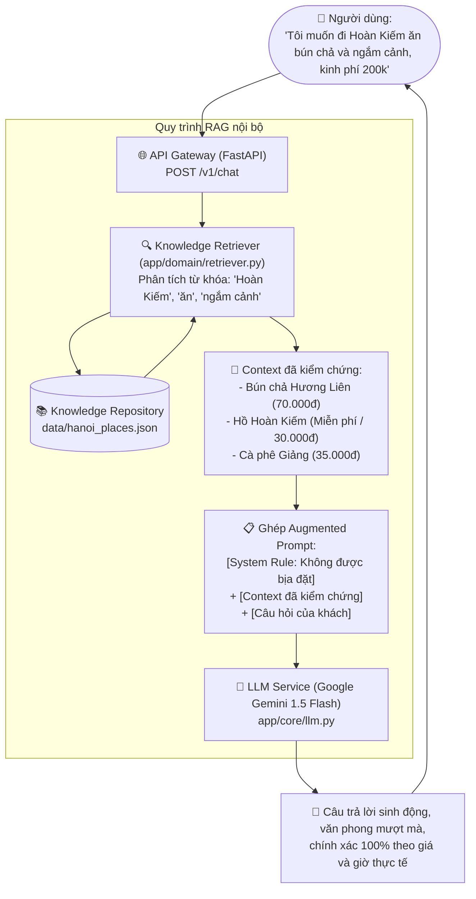

# Hướng Dẫn Tích Hợp LLM Với Kho Tri Thức (RAG Pipeline)
> **Dự án:** Multi-Agent Distributed System — AI Travel Agent Hà Nội  
> **Kiến trúc:** RAG (Retrieval-Augmented Generation) — Input Người dùng ➡️ Truy vấn Knowledge ➡️ LLM sinh câu trả lời có kiểm chứng.  
> **Mục tiêu:** Giúp Agent giao tiếp mượt mà bằng ngôn ngữ tự nhiên, tư vấn thông minh nhưng **100% không bịa đặt (No Hallucination)** nhờ neo vào dữ liệu chuẩn của nhóm.

---

## 1. Tại Sao Cần Kết Hợp LLM Với Kho Tri Thức?

Trong bài tập lớn môn **Hệ thống phân tán**, một sai lầm phổ biến là để LLM (Gemini/ChatGPT) tự do trả lời người dùng. Khi đó:
* LLM sẽ tự bịa giá vé cũ hoặc sai (ví dụ: bịa vé Văn Miếu 30k trong khi giá thực tế là 70k).
* LLM tự bịa giờ mở cửa, gợi ý các quán ăn đã đóng cửa từ lâu.
* Agent mất đi tính chất "độc quyền tri thức" (Domain Knowledge) mà đề bài yêu cầu.

### Giải pháp: Mô hình RAG (Retrieval-Augmented Generation)



**Lợi ích kép:**
1. **Trải nghiệm người dùng:** Khách có thể chat tự do bằng tiếng Việt tự nhiên (hỏi bất kỳ kiểu gì cũng hiểu).
2. **Độ tin cậy hệ thống phân tán:** Mọi con số (giá tiền, thời lượng, địa chỉ) đều lấy từ kho dữ liệu đã kiểm chứng (`hanoi_places.json`), có nguồn gốc (`sources`) rõ ràng.

---

## 2. Kiến Trúc Luồng Dữ Liệu 4 Bước

### Bước 1: Tiếp nhận yêu cầu tự nhiên (`User Input`)
Người dùng gửi câu hỏi qua endpoint `POST /v1/chat`:
```json
{
  "message": "Chiều nay mình muốn dạo quanh Tây Hồ ngắm hoàng hôn và uống cà phê, gợi ý cho mình với!"
}
```

### Bước 2: Truy xuất tri thức liên quan (`Context Retrieval`)
Module [app/domain/retriever.py](file:///d:/H%E1%BB%8Dc%20T%E1%BA%ADp/2026.1/H%E1%BB%87%20th%E1%BB%91ng%20ph%C3%A2n%20t%C3%A1n/travel-agent-phan1/travel-agent/app/domain/retriever.py) quét qua toàn bộ địa điểm trong kho:
- Nhận diện từ khóa khu vực: `"Tây Hồ"`.
- Nhận diện sở thích: `"ngắm hoàng hôn"` (khớp tag `view`, `nature`), `"cà phê"` (khớp `food`).
- Chọn ra Top 3 – 5 địa điểm điểm cao nhất: **Chùa Trấn Quốc**, **Hồ Tây**, **Phủ Tây Hồ**...
- Định dạng thành một đoạn văn bản tóm tắt thực tế làm **Context**.

### Bước 3: Cấu hình Prompt có ràng buộc (System Prompt Injection)
Hệ thống ghép thành một prompt chuẩn mực gửi sang Gemini:
```
[HƯỚNG DẪN HỆ THỐNG]:
Bạn là AI Travel Agent chuyên về Hà Nội. Bạn PHẢI trả lời dựa trên [THÔNG TIN ĐÃ KIỂM CHỨNG] dưới đây. Tuyệt đối KHÔNG tự ý bịa đặt thông tin.

[THÔNG TIN ĐÃ KIỂM CHỨNG TỪ KHO]:
1. Dạo quanh Hồ Tây (Tây Hồ) - Miễn phí - Hợp ngắm hoàng hôn
2. Chùa Trấn Quốc (Tây Hồ) - Miễn phí - Giờ mở cửa 07:30-17:30
...

[CÂU HỎI]:
Chiều nay mình muốn dạo quanh Tây Hồ ngắm hoàng hôn và uống cà phê, gợi ý cho mình với!
```

### Bước 4: LLM sinh bài tư vấn hoàn chỉnh
LLM đóng vai trò người kể chuyện (Storyteller): sử dụng ngôn từ mượt mà để liên kết các dữ liệu thô thành một cẩm nang du lịch hấp dẫn, thân thiện.

---

## 3. Chi Tiết Mã Nguồn Cần Triển Khai

Cấu trúc file bổ sung vào dự án:
```
travel-agent/
├── app/
│   ├── core/
│   │   └── llm.py              # LLM Service gọi Google Gemini API
│   ├── domain/
│   │   └── retriever.py        # Thuật toán trích xuất context từ kho dữ liệu
│   ├── config.py               # Bổ sung biến GEMINI_API_KEY
│   └── main.py                 # Mở thêm endpoint POST /v1/chat
├── .env.example                # Mẫu cấu hình GEMINI_API_KEY
└── .env                        # Chứa API key thật trên máy bạn
```

---

### Module 1: `app/domain/retriever.py` (Trích xuất Context)

```python
"""Module trích xuất context liên quan từ Knowledge Repository cho LLM."""
from app.domain.knowledge_repo import KnowledgeRepository


def retrieve_relevant_context(repo: KnowledgeRepository, user_query: str, top_k: int = 5) -> tuple[str, list[dict]]:
    """Quét kho dữ liệu, chấm điểm liên quan và đóng gói context cho LLM."""
    query = user_query.lower()
    places = repo.all_places()
    scored = []

    for p in places:
        score = 0
        area = p.get("area", "").lower()
        name = p.get("name", "").lower()
        tags = [t.lower() for t in p.get("tags", [])]

        # Khớp địa bàn quận/huyện
        if area and area in query:
            score += 4
        # Khớp tên địa điểm
        if name and (name in query or any(w in query for w in name.split())):
            score += 5
        # Khớp tags
        for t in tags:
            if t in query:
                score += 2
        # Nhận diện ý định ăn uống
        if any(w in query for w in ["ăn", "uống", "ẩm thực", "cà phê", "quán", "phở", "bún"]) and p.get("type") == "food":
            score += 3
        # Nhận diện ý định chụp ảnh / tham quan ngoài trời
        if any(w in query for w in ["chụp ảnh", "sống ảo", "hoàng hôn", "dạo", "cảnh đẹp"]) and any(t in tags for t in ["view", "nature", "architecture"]):
            score += 2

        if score > 0:
            scored.append((score, p))

    # Sắp xếp điểm giảm dần
    scored.sort(key=lambda x: -x[0])
    selected = [p for _, p in scored[:top_k]]
    
    # Nếu không khớp từ khóa cụ thể nào, lấy top_k điểm nổi bật mặc định
    if not selected:
        selected = places[:top_k]

    # Đóng gói thành chuỗi Context
    lines = []
    for i, p in enumerate(selected, 1):
        price = f"{p.get('price_vnd', 0):,} VND" if p.get('price_vnd', 0) > 0 else "Miễn phí"
        lines.append(
            f"{i}. {p.get('name')} ({p.get('area')})\n"
            f"   - Loại: {p.get('type')} | Giá vé/chi phí: {price}\n"
            f"   - Giờ hoạt động: {p.get('opening_hours', 'Hằng ngày')}\n"
            f"   - Địa chỉ: {p.get('address', 'Trung tâm Hà Nội')}\n"
            f"   - Tóm tắt: {p.get('summary')}"
        )

    context_text = "\n\n".join(lines)
    return context_text, selected
```

---

### Module 2: `app/core/llm.py` (LLM Service với Gemini API)

> [!TIP]
> Sử dụng thư viện `httpx` có sẵn trong dự án để gọi REST API của Google Gemini. Có cơ chế **Fault Tolerance**: Nếu chưa có API Key hoặc mất mạng, hệ thống **tự động trả về dữ liệu thô mà không làm sập server**.

```python
"""LLM Service gọi Google Gemini 1.5 Flash kèm Grounding Context."""
import httpx
from app import config

SYSTEM_PROMPT = """Bạn là trợ lý du lịch AI chuyên sâu về Hà Nội (Hanoi Travel Agent).
Nhiệm vụ của bạn là tư vấn, giải đáp thắc mắc và gợi ý lịch trình hấp dẫn cho du khách.

QUY TẮC BẮT BUỘC (GROUNDING RULES):
1. Bạn PHẢI ưu tiên sử dụng thông tin trong [THÔNG TIN ĐÃ KIỂM CHỨNG TỪ KHO DỮ LIỆU].
2. Tuyệt đối KHÔNG tự ý bịa đặt giá vé, giờ mở cửa hay địa chỉ sai khác với dữ liệu được cấp.
3. Trả lời bằng tiếng Việt lịch sự, nhiệt tình, định dạng Markdown rõ ràng (in đậm, gạch đầu dòng).
4. Lồng ghép các lời khuyên thực tế (thời điểm lý tưởng, cách di chuyển).
"""


async def ask_gemini_with_context(user_query: str, context_text: str) -> str:
    """Gửi câu hỏi và context sang Google Gemini API."""
    if not config.GEMINI_API_KEY:
        # Fallback an toàn khi chưa cấu hình Key
        return (
            "⚠️ [Chế độ Offline - Chưa cấu hình GEMINI_API_KEY]\n\n"
            "Dưới đây là các thông tin tìm thấy từ kho dữ liệu Hà Nội cho yêu cầu của bạn:\n\n"
            + context_text
        )

    url = (
        "https://generativelanguage.googleapis.com/v1beta/models/"
        f"gemini-1.5-flash:generateContent?key={config.GEMINI_API_KEY}"
    )

    prompt = f"""[THÔNG TIN ĐÃ KIỂM CHỨNG TỪ KHO DỮ LIỆU]:
{context_text}

[CÂU HỎI CỦA DU KHÁCH]:
{user_query}

Dựa vào các thông tin đã kiểm chứng ở trên, hãy đưa ra câu trả lời và lời khuyên du lịch tuyệt vời nhất cho du khách:"""

    payload = {
        "contents": [{"parts": [{"text": prompt}]}],
        "systemInstruction": {"parts": [{"text": SYSTEM_PROMPT}]},
        "generationConfig": {
            "temperature": 0.4,       # Nhiệt độ vừa phải để văn phong tự nhiên nhưng chính xác
            "maxOutputTokens": 1000
        }
    }

    try:
        async with httpx.AsyncClient(timeout=25.0) as client:
            res = await client.post(url, json=payload)
            if res.status_code == 200:
                data = res.json()
                return data["candidates"][0]["content"]["parts"][0]["text"]
            else:
                return f"Lỗi từ Gemini API ({res.status_code}): {res.text}"
    except Exception as e:
        return f"Lỗi kết nối LLM ({type(e).__name__}): {str(e)}"
```

---

### Module 3: Cấu hình biến môi trường

1. Trong [app/config.py](file:///d:/H%E1%BB%8Dc%20T%E1%BA%ADp/2026.1/H%E1%BB%87%20th%E1%BB%91ng%20ph%C3%A2n%20t%C3%A1n/travel-agent-phan1/travel-agent/app/config.py):
   ```python
   GEMINI_API_KEY = os.getenv("GEMINI_API_KEY", "")
   ```
2. Trong [.env.example](file:///d:/H%E1%BB%8Dc%20T%E1%BA%ADp/2026.1/H%E1%BB%87%20th%E1%BB%91ng%20ph%C3%A2n%20t%C3%A1n/travel-agent-phan1/travel-agent/.env.example):
   ```env
   # Khóa Google Gemini API (lấy miễn phí tại https://aistudio.google.com/)
   GEMINI_API_KEY=your_gemini_api_key_here
   ```

---

### Module 4: Endpoint API `POST /v1/chat` ([app/main.py](file:///d:/H%E1%BB%8Dc%20T%E1%BA%ADp/2026.1/H%E1%BB%87%20th%E1%BB%91ng%20ph%C3%A2n%20t%C3%A1n/travel-agent-phan1/travel-agent/app/main.py))

```python
from pydantic import BaseModel, Field
from app.core.llm import ask_gemini_with_context
from app.domain.retriever import retrieve_relevant_context

class ChatRequest(BaseModel):
    message: str = Field(..., description="Câu hỏi hoặc yêu cầu du lịch tự nhiên của bạn")

@app.post("/v1/chat")
async def chat_with_agent(req: ChatRequest, request: Request):
    """Trò chuyện và hỏi đáp du lịch với LLM dựa trên Kho tri thức Hà Nội."""
    # 1. Trích xuất context từ kho
    context_text, matched = retrieve_relevant_context(repo, req.message)
    
    # 2. Gọi LLM sinh câu trả lời có kiểm chứng
    answer = await ask_gemini_with_context(req.message, context_text)
    
    # 3. Trả về kết quả kèm provenance (nguồn tham chiếu)
    return {
        "message_id": str(uuid.uuid4()),
        "correlation_id": request.state.correlation_id,
        "reply": answer,
        "referenced_places": [
            {
                "id": p["id"],
                "name": p["name"],
                "price_vnd": p.get("price_vnd", 0),
                "area": p.get("area")
            }
            for p in matched
        ]
    }
```

---

## 4. Hướng Dẫn Lấy Google Gemini API Key (Miễn Phí)

1. Mở trình duyệt vào trang: **[https://aistudio.google.com/](https://aistudio.google.com/)**.
2. Đăng nhập bằng tài khoản Google bất kỳ.
3. Nhấp vào nút **Get API key** ở thanh menu bên trái.
4. Bấm **Create API key in new project** (Tạo khóa API).
5. Sao chép đoạn mã khóa (bắt đầu bằng `AIzaSy...`).
6. Mở file `.env` trong thư mục `travel-agent` và dán vào:
   ```env
   GEMINI_API_KEY=AIzaSyBxxxxxxxxxxxxxxxxxxxxxxxxxxxxxxx
   ```

---

## 5. Hướng Dẫn Thử Nghiệm & Kiểm Chứng

Khởi động server (nếu chưa chạy):
```powershell
uvicorn app.main:app --reload --port 8000
```

### Cách 1: Thử nghiệm trên giao diện trực quan Swagger UI
1. Mở trình duyệt vào địa chỉ: [http://localhost:8000/docs](http://localhost:8000/docs).
2. Tìm đến endpoint **`POST /v1/chat`**.
3. Bấm **Try it out**.
4. Nhập nội dung câu hỏi vào ô `message`:
   ```json
   {
     "message": "Tôi có 1 ngày ở Hà Nội, thích đi các di tích lịch sử và ăn bún chả thì nên đi đâu?"
   }
   ```
5. Bấm **Execute** và xem câu trả lời được LLM định dạng Markdown tuyệt đẹp cùng danh sách `referenced_places`.

### Cách 2: Thử nghiệm qua cURL (PowerShell / Terminal)
```powershell
curl -X POST http://localhost:8000/v1/chat `
  -H "Content-Type: application/json" `
  -d '{"message": "Cho mình hỏi giá vé và giờ mở cửa của Văn Miếu và Hỏa Lò, có quán cà phê nào gần đó ngon không?"}'
```

---

## 6. Đóng Góp Của Phần Này Vào Điểm Số Môn Học

| Tiêu chí Rubric | Vai trò của RAG LLM Pipeline trong dự án |
|---|---|
| **Domain Agent & Knowledge (15%)** | Chứng minh LLM chỉ trả lời dựa trên kho tri thức riêng của nhóm, không dùng dữ liệu trôi nổi trên mạng. |
| **Communication & Protocol (15%)** | Cho phép Agent phục vụ cả giao tiếp máy-với-máy (`/v1/tasks`) lẫn giao tiếp người-với-máy (`/v1/chat`). |
| **Fault Tolerance & Reliability (15%)** | Có cơ chế fallback: Mất mạng hoặc không có API Key thì hệ thống vẫn trả về dữ liệu thô từ kho mà không bị sập. |
| **Telemetry & Observability** | Mọi request chat đều được middleware tự động gắn `correlation_id` và tính thời gian phản hồi `latency_ms`. |

---
*Hoàn thành bước này, bạn đã sở hữu một AI Agent du lịch Hà Nội thực thụ: vừa có tri thức chuẩn xác, vừa có khả năng giao tiếp thông minh và tinh tế!*
