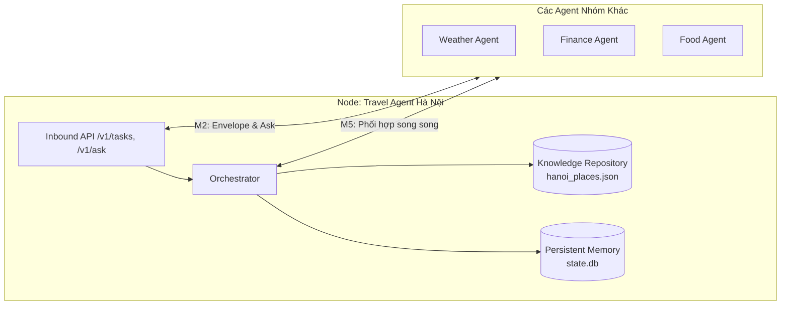
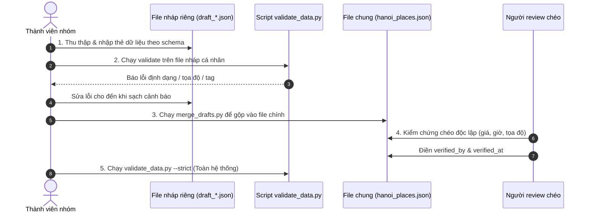

# Hướng Dẫn Chi Tiết Triển Khai Kho Dữ Liệu (Knowledge Repository)
> **Dự án:** Multi-Agent Distributed System — AI Travel Agent Hà Nội  
> **Tài liệu tham chiếu:** [HUONG_DAN_TRIEN_KHAI.md](file:///d:/H%E1%BB%8Dc%20T%E1%BA%ADp/2026.1/H%E1%BB%87%20th%E1%BB%91ng%20ph%C3%A2n%20t%C3%A1n/travel-agent-phan1/travel-agent/HUONG_DAN_TRIEN_KHAI.md)  
> **Mục tiêu:** Mở rộng, chuẩn hóa và kiểm chứng kho tri thức đạt **40 – 60 địa điểm**, hoàn thành Milestone **M1 Build** (chiếm 15% rubric).

---

## 1. Ý Nghĩa Của Kho Dữ Liệu Trong Hệ Thống Phân Tán

Trong môn học Hệ thống phân tán, các nhóm không xây dựng một ứng dụng đơn lẻ hay một chatbot thông thường. Mỗi nhóm phát triển một **Autonomous Agent (Node)** độc lập trong mạng lưới Multi-Agent của cả lớp.

Kho dữ liệu (`data/hanoi_places.json`) không đơn thuần là một file cấu hình tĩnh, mà là **Domain Knowledge** độc quyền của Agent:



### Tại sao dữ liệu phải sâu, chuẩn và có nguồn gốc?
1. **Lý do để các node khác phối hợp:** Nếu mọi nhóm đều có dữ liệu giống nhau hoặc tra cứu chung một API bên ngoài, hệ thống không cần đến kiến trúc phân tán. Agent Hà Nội sở hữu dữ liệu sâu, địa phương hóa và đã qua kiểm chứng (Verified Knowledge) — đây là lý do các Agent khác (như Tour Toàn quốc, Event, Chatbot tổng) phải gửi request nhờ Agent của bạn giải quyết.
2. **Nền tảng cho M2 (Communication - `/v1/ask`):** Cho phép agent khác truy vấn trực tiếp tri thức của bạn (ví dụ: *"Giá vé Văn Miếu hiện tại là bao nhiêu?"*), trả về kèm nguồn gốc (`sources`) và thời điểm kiểm chứng (`verified_at`).
3. **Nền tảng cho M4 (Replication & Consistency):** Khi lưu trữ tri thức nhận được từ agent khác, hệ thống dùng metadata (`sources`, `version`, `verified_at`) để xác định hạn sử dụng (TTL), phát hiện dữ liệu lỗi thời (`stale: true`) và giải quyết xung đột thông tin (conflict resolution).
4. **Nền tảng cho M5 (Coordination):** 
   - Trường `indoor: true/false` cho phép phối hợp với **Weather Agent**: Khi trời mưa, Orchestrator tự động ưu tiên các điểm trong nhà.
   - Trường `meal_slot` cho phép phối hợp với **Food Agent** hoặc sắp xếp khung giờ ăn uống hợp lý.
   - Trường `price_vnd` chính xác giúp **Finance Agent** tính toán ngân sách và tỷ giá không bị sai lệch.

---

## 2. Mục Tiêu Định Lượng & Tiêu Chí Nghiệm Thu (DoD)

### 2.1. Chỉ tiêu định lượng

| Chỉ tiêu | Mức tối thiểu | Mức khuyến nghị | Mục đích trong hệ thống |
|---|:---:|:---:|---|
| **Tổng số địa điểm** | **40** | **50 – 60** | Đủ độ phủ để thuật toán xếp lịch không bị lặp |
| **Cơ cấu loại (`type`)** | — | **~26** `sight`, **~16** `food`, **~8** `experience` | Đa dạng hóa dịch vụ du lịch |
| **Độ phủ khu vực** | ≥ 3 điểm/quận | ≥ 5 điểm cho các quận trung tâm | Đảm bảo lập tour theo cụm địa lý tối ưu |
| **Địa điểm trong nhà (`indoor: true`)** | **≥ 12** | **≥ 15** | Phục vụ kịch bản thời tiết mưa (M5) |
| **Địa điểm miễn phí / ≤ 50.000đ** | **≥ 12** | **≥ 15** | Phục vụ cơ chế tự điều chỉnh ngân sách (Budget) |
| **Đầy đủ nguồn gốc (`sources`)** | **100%** | **100%** | Đảm bảo tính minh bạch dữ liệu (Provenance - M4) |
| **Kiểm chứng độc lập (≥ 2 nguồn)** | Địa điểm thu phí | 100% tất cả địa điểm | Tránh sai số chi phí và giờ hoạt động |

### 2.2. Tiêu chí hoàn thành (Definition of Done - DoD)
- [ ] Chạy lệnh `python scripts/validate_data.py --strict` đạt **0 ERROR** và **0 WARN**.
- [ ] 100% thẻ dữ liệu có `sources` hợp lệ (URL truy cập được, có ngày `accessed`), có `verified_at` và `verified_by`.
- [ ] Mỗi thẻ dữ liệu do một thành viên thu thập phải được một thành viên **khác** kiểm tra chéo (Cross-check).
- [ ] Kiểm thử thành công 3 kịch bản tour qua API `/v1/tasks` (Lịch 1 ngày Lịch sử, Lịch 2 ngày Ẩm thực, Lịch ngân sách thấp).
- [ ] Đã cập nhật trường `version` trong `data/hanoi_places.json` (ví dụ: `"2026.10-v1.0"`).

---

## 3. Kiến Trúc Thư Mục & Quy Trình Làm Việc Không Xung Đột

Để tránh tình trạng 4 thành viên cùng sửa một file JSON gây ra xung đột mã (git merge conflict), dự án thiết kế cơ chế **file nháp độc lập (drafts)**:

```
travel-agent/
├── data/
│   ├── hanoi_places.json           # File tri thức chính thức (Source of Truth)
│   ├── archive/                    # Bản sao lưu tự động sinh ra khi gộp dữ liệu
│   │   └── hanoi_places_*.json
│   └── drafts/                     # Thư mục làm việc cá nhân của từng thành viên
│       ├── draft_A_hoankiem.json   # Thành viên A phụ trách
│       ├── draft_B_badinh.json     # Thành viên B phụ trách
│       ├── draft_C_taybo.json      # Thành viên C phụ trách
│       └── draft_D_amthuc.json     # Thành viên D phụ trách
├── scripts/
│   ├── validate_data.py            # Kiểm tra quy chuẩn chất lượng dữ liệu
│   └── merge_drafts.py             # Gộp các file draft vào file chính + tự động backup
└── app/
    └── domain/
        └── knowledge_repo.py       # Knowledge Repository nạp dữ liệu vào bộ nhớ
```

### Phân công công việc (4 thành viên)

| Thành viên | File nháp phụ trách | Phạm vi địa lý / Nghiệp vụ | Mục tiêu số lượng |
|:---:|---|---|:---:|
| **Thành viên A** | [data/drafts/draft_A_hoankiem.json](travel-agent/data/drafts/draft_A_hoankiem.json) | Quận Hoàn Kiếm, Khu phố cổ, Nhà tù Hỏa Lò, Nhà hát Lớn... | 12 – 15 điểm |
| **Thành viên B** | [data/drafts/draft_B_badinh.json](travel-agent/data/drafts/draft_B_badinh.json) | Ba Đình, Đống Đa, Cầu Giấy (Lăng Bác, Hoàng Thành, Văn Miếu, Dân tộc học...) | 12 – 15 điểm |
| **Thành viên C** | [data/drafts/draft_C_taybo.json](travel-agent/data/drafts/draft_C_taybo.json) | Tây Hồ, Long Biên, Hai Bà Trưng (Chùa Trấn Quốc, Phủ Tây Hồ, Công viên Thống Nhất...) | 12 – 15 điểm |
| **Thành viên D** | [data/drafts/draft_D_amthuc.json](travel-agent/data/drafts/draft_D_amthuc.json) | Ẩm thực đặc trưng toàn thành (quán cụ thể) & Làng nghề ven đô (Bát Tràng, Vạn Phúc...) | 12 – 15 điểm |

---

## 4. Chuẩn Thẻ Dữ Liệu (Data Schema Chi Tiết)

Nội dung mỗi file trong `data/drafts/*.json` phải là một **mảng JSON gồm các đối tượng thẻ dữ liệu**:
`[ { ... }, { ... } ]`.

### 4.1. Mẫu thẻ điểm tham quan / trải nghiệm (`sight` hoặc `experience`)

```json
{
  "id": "van-mieu",
  "name": "Văn Miếu - Quốc Tử Giám",
  "type": "sight",
  "area": "Đống Đa",
  "address": "58 Phố Quốc Tử Giám, Văn Miếu, Đống Đa, Hà Nội",
  "tags": ["history", "culture", "architecture"],
  "price_vnd": 70000,
  "price_note": "Người lớn 70.000đ; học sinh, sinh viên có thẻ 35.000đ; trẻ em dưới 16 tuổi miễn phí (áp dụng từ 2024)",
  "duration_min": 90,
  "opening_hours": "Hằng ngày 08:00-17:00 (mùa đông); 07:30-17:30 (mùa hè)",
  "indoor": false,
  "best_time": "Buổi sáng sớm 08:00-10:00 hoặc đầu giờ chiều, thời tiết mát mẻ",
  "lat": 21.0293,
  "lon": 105.8355,
  "summary": "Trường đại học đầu tiên của Việt Nam với kiến trúc cổ kính thời Lý - Lê, nổi bật với Khuê Văn Các và 82 bia Tiến sĩ vinh danh hiền tài.",
  "sources": [
    {
      "url": "http://vanmieu.gov.vn",
      "accessed": "2026-10-17"
    },
    {
      "url": "https://maps.app.goo.gl/vanmieu-official",
      "accessed": "2026-10-17"
    }
  ],
  "verified_at": "2026-10-17",
  "verified_by": "NguyenVanA"
}
```

### 4.2. Mẫu thẻ ẩm thực (`food`) — Bắt buộc thêm `meal_slot`

> [!IMPORTANT]
> Đối với địa điểm ăn uống, phải chọn một quán **thực tế cụ thể** (có địa chỉ, còn hoạt động), không ghi chung chung như "Quán phở gần hồ". Bắt buộc có trường `"meal_slot"`.

```json
{
  "id": "pho-gia-truyen-bat-dan",
  "name": "Phở Gia Truyền Bát Đàn",
  "type": "food",
  "area": "Hoàn Kiếm",
  "address": "49 Bát Đàn, Cửa Đông, Hoàn Kiếm, Hà Nội",
  "tags": ["food", "culture"],
  "price_vnd": 60000,
  "price_note": "Phở tái chín 60.000đ/bát, phở đặc biệt 70.000đ/bát (thanh toán tiền mặt/chuyển khoản tại quầy)",
  "duration_min": 45,
  "opening_hours": "06:00-10:00 và 18:00-20:30 (thường hết sớm vào buổi sáng)",
  "meal_slot": "breakfast",
  "indoor": true,
  "best_time": "06:30-07:30 sáng để tránh phải xếp hàng quá lâu",
  "lat": 21.0345,
  "lon": 105.8475,
  "summary": "Quán phở bò gia truyền nổi tiếng phố cổ với nước dùng trong veo, đậm đà vị ngọt xương và nét văn hóa xếp hàng tự phục vụ đặc trưng.",
  "sources": [
    {
      "url": "https://vietnamtourism.gov.vn/post/am-thuc-pho-bat-dan",
      "accessed": "2026-10-17"
    },
    {
      "url": "https://maps.google.com/?cid=123456789",
      "accessed": "2026-10-17"
    }
  ],
  "verified_at": "2026-10-17",
  "verified_by": "TranThiB"
}
```

### 4.3. Bảng quy chuẩn các trường dữ liệu

| Tên trường | Kiểu dữ liệu | Bắt buộc | Quy chuẩn / Ràng buộc kỹ thuật |
|---|:---:|:---:|---|
| `id` | `string` | **Có** | Chuỗi slug chữ thường, không dấu, nối nhau bằng dấu gạch ngang (Regex: `^[a-z0-9]+(-[a-z0-9]+)*$`). Ví dụ: `chua-tran-quoc`. Không được trùng lặp. |
| `name` | `string` | **Có** | Tên chuẩn tiếng Việt có dấu. Ví dụ: `"Chùa Trấn Quốc"`. |
| `type` | `string` | **Có** | Chỉ được chọn 1 trong 3 giá trị: `"sight"` (tham quan), `"food"` (ăn uống), `"experience"` (trải nghiệm, workshop, làng nghề). |
| `area` | `string` | **Có** | Tên quận/huyện: `"Hoàn Kiếm"`, `"Ba Đình"`, `"Đống Đa"`, `"Tây Hồ"`, `"Hai Bà Trưng"`, `"Cầu Giấy"`, `"Gia Lâm"`, `"Hà Đông"`... |
| `address` | `string` | Khuyên dùng | Địa chỉ chi tiết số nhà, phố, phường. |
| `tags` | `list[str]` | **Có** | Mảng các tag lấy từ **Danh mục 13 tag chuẩn** (xem bảng mục 4.4). Tối thiểu 1 tag. |
| `price_vnd` | `int` | **Có** | Giá vé hoặc chi phí suất ăn cơ bản (VND). Số nguyên ≥ 0. Nếu miễn phí thì ghi `0`. |
| `price_note` | `string` | Khuyên dùng | Ghi chú chi tiết đối tượng miễn giảm giá, ngày áp dụng chính sách mới. |
| `duration_min` | `int` | **Có** | Thời lượng ước tính trải nghiệm (phút). Số nguyên từ `15` đến `300`. |
| `opening_hours`| `string` | **Có** | Khung giờ mở cửa trong ngày, ghi rõ ngày đóng cửa nếu có (ví dụ: *"Đóng cửa thứ 2"*). |
| `meal_slot` | `string` | **Bắt buộc nếu type=food** | Chọn 1 trong 4 khung: `"breakfast"`, `"lunch"`, `"dinner"`, `"snack"`. |
| `indoor` | `bool` | **Có** | `true` nếu là không gian kín/trong nhà (bảo tàng, quán cafe, di tích trong nhà); `false` nếu ngoài trời. |
| `best_time` | `string` | Khuyên dùng | Thời điểm lý tưởng trong ngày/mùa để có trải nghiệm tốt nhất. |
| `lat` | `float` | **khuyên dùng** | Vĩ độ (Hà Nội khoảng `20.5` đến `21.5`, nội thành `20.90` – `21.15`). |
| `lon` | `float` | **Khuyên dùng** | Kinh độ (Hà Nội khoảng `105.3` đến `106.2`, nội thành `105.70` – `106.00`). |
| `summary` | `string` | **Có** | Đoạn tóm tắt từ **2 – 3 câu** (≥ 20 ký tự) |
| `sources` | `list[dict]` | **Khuyên dùng** | Danh sách nguồn đối chiếu: `[{"url": "...", "accessed": "YYYY-MM-DD"}]`. Địa điểm có thu phí **cần ≥ 2 nguồn độc lập**. |
| `verified_at` | `string` | **Có** | Ngày kiểm tra gần nhất (định dạng `YYYY-MM-DD`). Không được cũ quá 180 ngày. |
| `verified_by` | `string` | **Có** | Tên hoặc mã thành viên kiểm tra chéo (người review). |

### 4.4. Danh mục 13 Tag chuẩn (Allowed Tags)
Hệ thống chỉ chấp nhận 13 tag sau để đảm bảo thuật toán phân loại và matching sở thích chạy chính xác:
```
history · culture · museum · architecture · spiritual · nature · view · food · shopping · craft · nightlife · family · art
```
*(Nếu nhập tag lạ nằm ngoài 13 từ khóa trên, script kiểm tra sẽ đưa ra cảnh báo)*.

---

## 5. Quy Trình 8 Bước Thực Hiện Chi Tiết



### Bước 1: Khởi động môi trường làm việc
Mở terminal tại thư mục gốc của dự án (`travel-agent`):
```powershell
# Kích hoạt virtualenv trên Windows PowerShell:
.venv\Scripts\Activate.ps1

# Cài đặt thư viện nếu chưa đủ:
pip install -r requirements.txt
```

### Bước 2: Nhận file draft và chọn danh sách địa điểm
Mỗi thành viên mở file nháp được phân công trong [data/drafts/](file:///d:/H%E1%BB%8Dc%20T%E1%BA%ADp/2026.1/H%E1%BB%87%20th%E1%BB%91ng%20ph%C3%A2n%20t%C3%A1n/travel-agent-phan1/travel-agent/data/drafts/). Tham khảo danh sách gợi ý ở [Mục 8](#8-phụ-lục-danh-sách-địa-điểm-gợi-ý-theo-thành-viên) để chọn khoảng 12 – 15 điểm cho khu vực của mình.

### Bước 3: Kiểm chứng nguồn tin cậy (Quy tắc 2 nguồn độc lập)
Thu thập thông tin theo thứ tự ưu tiên độ tin cậy:
1. **Mức 1 (Độ tin cậy cao nhất):** Website chính thức của ban quản lý (ví dụ: `hoangthanhthanglong.vn`, `vanmieu.gov.vn`), cổng thông tin Sở Du lịch Hà Nội (`dulichhanoi.gov.vn`). Sử dụng để chốt giá vé, giờ mở cửa và các ngày nghỉ lễ/đóng cửa định kỳ.
2. **Mức 2:** Google Maps (thông tin do cơ sở cập nhật, hình ảnh bảng giá thực tế chụp trong vòng 1-3 tháng gần đây, mục hỏi đáp).
3. **Mức 3:** Báo chí uy tín (VnExpress Du lịch, Tuổi Trẻ, Cổng thông tin Chính phủ).
4. **Mức 4 (Không dùng làm nguồn duy nhất):** Blog cá nhân, diễn đàn du lịch cũ (thông tin giá vé trước năm 2024 thường đã tăng hoặc thay đổi).

> [!CAUTION]
> **Quy tắc cứng:** Mọi địa điểm có thu phí (`price_vnd > 0`) **bắt buộc phải có ít nhất 2 URL nguồn độc lập**. Nếu có chênh lệch giá giữa 2 nguồn, ưu tiên nguồn mới nhất và ghi rõ vào trường `price_note`.

### Bước 4: Lấy tọa độ GPS chuẩn xác từ Google Maps
1. Mở [Google Maps](https://www.google.com/maps).
2. Tìm đến đúng vị trí **cổng vào hoặc cửa đón khách** của địa điểm.
3. Nhấp chuột phải trực tiếp vào điểm đó.
4. Nhấp chuột trái vào dòng đầu tiên hiển thị dãy số tọa độ (ví dụ: `21.029312, 105.835489`) để sao chép vào bộ nhớ đệm (Clipboard).
5. Dán vào file JSON: Số đầu tiên là `lat` (khoảng `21.0...`), số thứ hai là `lon` (khoảng `105.8...`).
   - *Lưu ý:* Tuyệt đối không đảo ngược thành `lat = 105` và `lon = 21` (khiến địa điểm bay sang tận biển Ấn Độ Dương).

### Bước 5: Tự viết mô tả độc quyền (`summary`)
- Viết tóm tắt súc tích trong 2 – 3 câu văn tự nhiên của nhóm.
- **Không sao chép nguyên văn** từ Wikipedia hay báo chí.
- Nên lồng ghép mẹo thực tế (ví dụ: *"Nên đến trước 16h vì quầy vé dừng tiếp khách sớm"*, *"Thích hợp ghé vào buổi tối ngắm phố đi bộ"*).

### Bước 6: Kiểm tra tính hợp lệ của file nháp
Trước khi gộp vào file chung, bạn có thể chạy kiểm tra riêng file của mình:
```powershell
$env:PYTHONUTF8="1"
python scripts/validate_data.py data/drafts/draft_A_hoankiem.json
```
*(Nếu terminal báo thiếu trường hay sai tag, hãy chỉnh sửa ngay trong file draft)*.

### Bước 7: Gộp dữ liệu bằng `merge_drafts.py`
Khi các thành viên đã hoàn thành file draft, chạy script gộp tự động:

```powershell
# 1. Chạy thử nghiệm để kiểm tra các điểm sẽ được thêm mới hoặc trùng lặp:
python scripts/merge_drafts.py --dry-run

# 2. Thực hiện gộp thật vào data/hanoi_places.json:
python scripts/merge_drafts.py

# (Tùy chọn) Nếu muốn nội dung trong draft ghi đè lên các điểm cũ cùng ID:
python scripts/merge_drafts.py --overwrite
```
*Script sẽ tự động sao lưu bản cũ vào thư mục `data/archive/hanoi_places_YYYYMMDD_HHMMSS.json` trước khi ghi dữ liệu mới.*

### Bước 8: Kiểm tra chéo (Cross-check) & Nghiệm thu `--strict`
1. Thành viên này kiểm tra dữ liệu do thành viên khác nhập (đối chiếu lại giá vé, giờ mở cửa, gọi thử số điện thoại nếu cần).
2. Khi xác nhận thông tin chuẩn xác, điền tên của mình vào trường `"verified_by": "TenNguoiReview"`.
3. Chạy lệnh kiểm tra nghiêm ngặt toàn bộ kho dữ liệu:
```powershell
$env:PYTHONUTF8="1"
python scripts/validate_data.py --strict
```
Khi màn hình hiển thị:
```
Tổng: 52 địa điểm | theo loại: {'sight': 28, 'food': 16, 'experience': 8}
...
Kết quả: 0 lỗi, 0 cảnh báo (chế độ strict)
```
→ **Kho dữ liệu đã chính thức đạt chuẩn nghiệm thu M1!**

---

## 6. Hướng Dẫn Sử Dụng Bộ Công Cụ Script & Khắc Phục Sự Cố

### 6.1. Hướng dẫn lệnh chạy

| Lệnh | Ý nghĩa | Thời điểm sử dụng |
|---|---|---|
| `$env:PYTHONUTF8="1"; python scripts/validate_data.py` | Kiểm tra cấu trúc dữ liệu, thiếu nguồn chỉ cảnh báo (WARN) | Trong quá trình đang thu thập |
| `$env:PYTHONUTF8="1"; python scripts/validate_data.py --strict` | Chế độ nghiêm ngặt: mọi cảnh báo nguồn/kiểm chứng thành ERROR | Trước khi commit và báo cáo hoàn thành |
| `python scripts/merge_drafts.py --dry-run` | Giả lập gộp dữ liệu, xem trước số lượng thêm/trùng | Trước khi gộp thật |
| `python scripts/merge_drafts.py` | Gộp file nháp vào file chính, giữ nguyên điểm đã có nếu trùng ID | Khi gộp dữ liệu nhóm |
| `python scripts/merge_drafts.py --overwrite` | Gộp file nháp và ghi đè nội dung mới lên ID cũ | Khi cập nhật thông tin mới cho các điểm có sẵn |

### 6.2. Các sự cố thường gặp & Cách xử lý nhanh

#### Lỗi 1: `UnicodeEncodeError: 'charmap' codec can't encode character...`
- **Nguyên nhân:** Console Windows (PowerShell/CMD) mặc định dùng bảng mã cp1252/cp936, không in được ký tự tiếng Việt UTF-8.
- **Cách khắc phục:** Thiết lập biến môi trường UTF-8 trong PowerShell trước khi chạy lệnh:
  ```powershell
  $env:PYTHONUTF8="1"
  python scripts/validate_data.py
  ```

#### Lỗi 2: `[id] tọa độ nằm ngoài Hà Nội, có thể nhầm lat/lon`
- **Nguyên nhân:** Nhập nhầm thứ tự giữa kinh độ và vĩ độ (ví dụ nhập `lat: 105.85, lon: 21.02`).
- **Cách khắc phục:** Đảo lại giá trị: Vĩ độ `lat` phải là `21.xxx`, kinh độ `lon` phải là `105.xxx`.

#### Lỗi 3: `[id] cách '[id-khac]' dưới 30m, có thể trùng địa điểm`
- **Nguyên nhân:** Hai thành viên thu thập cùng một địa điểm nhưng đặt hai `id` khác nhau, hoặc hai quán ăn nằm sát vách nhau.
- **Cách khắc phục:** 
  - Nếu trùng địa điểm: Thống nhất giữ lại một thẻ đầy đủ hơn, xóa thẻ còn lại.
  - Nếu là hai điểm khác nhau (ví dụ: Đền Ngọc Sơn và Cầu Thê Húc): Ghi chú rõ vị trí cụ thể trong `summary`.

#### Lỗi 4: `[id] id phải là slug chữ thường-không-dấu`
- **Nguyên nhân:** Đặt id có dấu tiếng Việt, có dấu cách, chữ hoa hoặc ký tự lạ (ví dụ: `"Ho_Guom"`, `"van mieu"`).
- **Cách khắc phục:** Đổi thành chữ thường không dấu, phân tách bằng dấu gạch ngang (ví dụ: `"ho-guom"`, `"van-mieu"`).

---

## 7. Kiểm Thử Tích Hợp Hệ Thống (End-to-End Verification)

Sau khi dữ liệu đã được gộp vào `data/hanoi_places.json`, cần kiểm chứng xem Agent có thực sự nạp và sử dụng kho dữ liệu mới vào việc tính toán chi phí và lập lịch trình hay không.

### 7.1. Khởi động Agent
```powershell
uvicorn app.main:app --reload --port 8000
```

### 7.2. Kiểm tra Health Check & Agent Card
Mở trình duyệt hoặc dùng `curl` trong terminal khác:
```powershell
# 1. Kiểm tra trạng thái và phiên bản dữ liệu nạp vào:
curl http://localhost:8000/health
# Kết quả mong đợi: {"status":"ok","agent_id":"travel-hanoi-agent","knowledge_version":"..."}

# 2. Kiểm tra Agent Card:
curl http://localhost:8000/.well-known/agent-card.json
```

### 7.3. Thử nghiệm 3 kịch bản thực tế qua `/v1/tasks`

#### Kịch bản 1: Tour 1 ngày tập trung di tích lịch sử cho 2 người
```powershell
curl -X POST http://localhost:8000/v1/tasks `
  -H "Content-Type: application/json" `
  -d '{"days": 1, "travelers": 2, "interests": ["history", "culture"]}'
```
*Đánh giá kết quả:*
- Lịch trình ngày 1 có các điểm lịch sử điểm cao (Văn Miếu, Hoàng Thành, Hỏa Lò...).
- Tổng thời gian `total_minutes <= 480` (8 tiếng/ngày).
- Khoảng cách di chuyển giữa các điểm hợp lý (không đi vòng vèo xuyên thành phố).

#### Kịch bản 2: Tour 2 ngày trải nghiệm ẩm thực phố cổ
```powershell
curl -X POST http://localhost:8000/v1/tasks `
  -H "Content-Type: application/json" `
  -d '{"days": 2, "travelers": 2, "interests": ["food", "culture"]}'
```
*Đánh giá kết quả:*
- Có sự xuất hiện của các quán ăn đặc trưng trong danh sách điểm dừng.

#### Kịch bản 3: Tour 2 ngày với ngân sách giới hạn (Kiểm tra cơ chế tự thích ứng)
```powershell
curl -X POST http://localhost:8000/v1/tasks `
  -H "Content-Type: application/json" `
  -d '{"days": 2, "travelers": 2, "budget_vnd": 600000, "interests": ["history"]}'
```
*Đánh giá kết quả:*
- Trường `"adjusted_for_budget": true`.
- Hệ thống tự động ưu tiên các địa điểm miễn phí hoặc giá rẻ để tổng chi phí không vượt quá 600.000đ.

---

## 8. Phụ Lục: Danh Sách Địa Điểm Gợi Ý Theo Thành Viên

Dưới đây là danh sách phân chia gợi ý để 4 thành viên nhanh chóng phân bổ công việc (nhóm có thể linh hoạt bổ sung hoặc thay đổi điểm phù hợp):

### Phân công Người A — Khu vực Hoàn Kiếm & Phố cổ (`draft_A_hoankiem.json`)
1. **hoan-kiem**: Hồ Hoàn Kiếm & Đền Ngọc Sơn (Sight, 30.000đ, outdoor)
2. **hoa-lo**: Di tích Nhà tù Hỏa Lò (Sight, 50.000đ, indoor)
3. **nha-hat-lon**: Nhà hát Lớn Hà Nội (Sight, 0đ check-in / có vé tour, architecture)
4. **cau-long-bien**: Cầu Long Biên (Sight, 0đ, view/history, outdoor)
5. **phu-nu**: Bảo tàng Phụ nữ Việt Nam (Sight, 40.000đ, indoor)
6. **dong-xuan**: Chợ Đồng Xuân (Sight/Shopping, 0đ, indoor)
7. **o-quan-chuong**: Ô Quan Chưởng (Sight, 0đ, history, outdoor)
8. **nha-tho-lon**: Nhà thờ Lớn Hà Nội (Sight, 0đ, architecture, outdoor)
9. **nha-co-ma-may**: Nhà cổ 87 Mã Mây (Sight, 10.000đ, culture, indoor)
10. **pho-sach-ha-noi**: Phố Sách Hà Nội 19/12 (Sight/Culture, 0đ, outdoor)
11. **mua-roi-nuoc-thang-long**: Nhà hát Múa rối Thăng Long (Experience, 100.000đ - 200.000đ, indoor)
12. **pho-di-bo-ho-guom**: Phố đi bộ Hồ Gươm (cuối tuần) (Experience/Nightlife, 0đ, outdoor)

### Phân công Người B — Khu vực Ba Đình, Đống Đa, Cầu Giấy (`draft_B_badinh.json`)
1. **van-mieu**: Văn Miếu - Quốc Tử Giám (Sight, 70.000đ, indoor/outdoor)
2. **lang-bac**: Lăng Chủ tịch Hồ Chí Minh & Phủ Chủ tịch (Sight, 0đ người Việt, history)
3. **chua-mot-cot**: Chùa Một Cột (Sight, 0đ, spiritual, outdoor)
4. **hoang-thanh**: Hoàng thành Thăng Long (Sight, 150.000đ, outdoor/indoor)
5. **dan-toc-hoc**: Bảo tàng Dân tộc học Việt Nam (Sight, 40.000đ, indoor/outdoor)
6. **my-thuat**: Bảo tàng Mỹ thuật Việt Nam (Sight, 40.000đ, indoor)
7. **lich-su-quan-su**: Bảo tàng Lịch sử Quân sự Việt Nam (Sight mới tại Tây Mỗ / Nam Từ Liêm, indoor)
8. **bao-tang-ho-chi-minh**: Bảo tàng Hồ Chí Minh (Sight, 40.000đ, indoor)
9. **cot-co-ha-noi**: Cột cờ Hà Nội (trong khuôn viên Bảo tàng Quân sự, history)
10. **chua-lang**: Chùa Láng (Chiêu Thiền Tự) (Sight, 0đ, spiritual)
11. **cong-vien-thu-le**: Công viên Thủ Lệ (Sight/Family, 30.000đ, outdoor)
12. **dai-quan-sat-lotte**: Đài quan sát Lotte Center Hà Nội Sky (Experience/View, 180.000đ - 230.000đ, indoor)

### Phân công Người C — Khu vực Tây Hồ, Long Biên, Hai Bà Trưng (`draft_C_taybo.json`)
1. **chua-tran-quoc**: Chùa Trấn Quốc (Sight, 0đ, spiritual, outdoor)
2. **phu-tay-ho**: Phủ Tây Hồ (Sight, 0đ, spiritual, outdoor)
3. **ho-tay**: Đường dạo ven Hồ Tây & Bến Hàn Quốc (Sight, 0đ, view/nature)
4. **den-quan-thanh**: Đền Quán Thánh (Sight, 10.000đ, spiritual)
5. **thung-lung-hoa-ho-tay**: Thung lũng hoa Hồ Tây (Sight/Experience, 100.000đ, outdoor)
6. **cong-vien-thong-nhat**: Công viên Thống Nhất (Sight, 0đ, nature/family)
7. **chua-quan-su**: Chùa Quán Sứ (Sight, 0đ, spiritual)
8. **bao-tang-lich-su-quoc-gia**: Bảo tàng Lịch sử Quốc gia (Tràng Tiền) (Sight, 40.000đ, indoor)
9. **aeon-mall-long-bien**: Trung tâm thương mại Aeon Mall Long Biên (Shopping/Family, indoor)
10. **lang-hoa-quang-ba**: Chợ hoa đêm Quảng Bá (Experience/Nightlife, 0đ)
11. **xe-dien-pho-co**: Trải nghiệm tour xe điện phố cổ (Experience, 35.000đ/người)

### Phân công Người D — Ẩm thực & Làng nghề ven đô (`draft_D_amthuc.json`)
1. **pho-thin-lo-duc**: Phở Thìn 13 Lò Đúc (Food, 70.000đ - 90.000đ, breakfast/lunch)
2. **bun-cha-huong-lien**: Bún chả Hương Liên (Obama) 24 Lê Văn Hưu (Food, 60.000đ - 80.000đ, lunch)
3. **ca-phe-giang**: Cà phê Giảng 39 Nguyễn Hữu Huân (Food/Culture, 35.000đ, snack)
4. **cha-ca-thang-long**: Chả cá Thăng Long 19-21-2D Đường Thành (Food, 130.000đ - 150.000đ, lunch/dinner)
5. **bun-dau-hang-khay**: Bún đậu ngõ 31 Hàng Khay (Food, 45.000đ - 65.000đ, lunch)
6. **banh-cuon-ba-hoanh**: Bánh cuốn Bà Hoành 66 Tô Hiến Thành (Food, 40.000đ - 60.000đ, breakfast/lunch)
7. **xoi-yen**: Xôi Yến 35B Nguyễn Hữu Huân (Food, 40.000đ - 60.000đ, breakfast/dinner)
8. **kem-trang-tien**: Kem Tràng Tiền 35 Tràng Tiền (Food, 15.000đ - 25.000đ, snack)
9. **banh-tom-ho-tay**: Bánh tôm Hồ Tây 1 Thanh Niên (Food, 80.000đ - 120.000đ, dinner)
10. **pho-cuon-huong-mai**: Phở cuốn Hương Mai Ngũ Xã (Food, 70.000đ - 100.000đ, lunch/dinner)
11. **bat-trang**: Làng gốm Bát Tràng (Gia Lâm) (Experience/Craft, 50.000đ workshop, outdoor/indoor)
12. **van-phuc**: Làng lụa Vạn Phúc (Hà Đông) (Experience/Craft/Shopping, 0đ, outdoor)

---

## 9. Lịch Biểu Đề Xuất Cho Nhóm

```
Ngày 1: Họp nhóm chốt danh sách địa điểm theo 4 file nháp (A, B, C, D)
Ngày 2-3: Thu thập, đối chiếu 2 nguồn độc lập, lấy tọa độ GPS Maps
Ngày 4: Tự validate file nháp của mình, sửa sạch lỗi cú pháp
Ngày 5: Chạy merge_drafts.py gộp vào hanoi_places.json
Ngày 6: Kiểm tra chéo (Cross-check), điền verified_by, chạy validate --strict
Ngày 7: Chạy thử nghiệm 3 kịch bản qua /v1/tasks và nộp bài M1 Build
```

---
*Chúc nhóm hoàn thành xuất sắc kho dữ liệu du lịch Hà Nội và đạt điểm tối đa Milestone M1 Build!*
